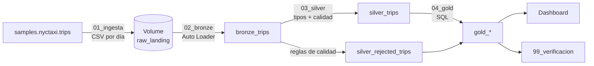

# NYC Taxi: Pipeline Medallion en Databricks

Pipeline de datos end-to-end con arquitectura **Medallion (Bronze / Silver / Gold)** sobre Delta Lake, construido en **Databricks Free Edition**. Ingesta incremental con Auto Loader, validación de calidad con tabla de rechazados, orquestación con Databricks Jobs y dashboard con KPIs de negocio.

**Stack utilizado:** PySpark · SQL · Delta Lake · Auto Loader · Unity Catalog (Volumes) · Databricks Jobs · Databricks Dashboards

---

## Arquitectura



| Capa | Tabla | Qué contiene |
|---|---|---|
| Landing | Volume `raw_landing` | Un CSV por día de recogida, simulando archivos que llegan de un sistema externo |
| Bronze | `bronze_trips` | Datos tal cual llegan (todo string) + `source_files` e `ingestion_ts` |
| Silver | `silver_trips` | Tipos correctos, validados, con `trip_id`, `duration_min`, `speed_mph`, `pickup_date`, `pickup_hour`, `pickup_dow` |
| Silver | `silver_rejected_trips` | Registros que incumplen alguna regla, con el motivo en `reject_reasons` |
| Gold | `gold_demand_by_hour`, `gold_revenue_by_zone`, `gold_fare_by_distance`, `gold_daily_kpis`, `gold_data_quality` | Agregados listos para el dashboard |

## Estructura del repositorio

```
nyctaxi-medallion-databricks/
├── notebooks/
│   ├── 00_setup.sql             # catálogo, schema y Volume
│   ├── 00_mantenimiento.ipynb      # reset de Bronze (NO forma parte del Job)
│   ├── 01_ingesta.ipynb            # aterriza CSV por día (parametrizado)
│   ├── 02_bronze.ipynb             # Auto Loader -> bronze_trips
│   ├── 03_silver.ipynb             # tipos, calidad, rechazados
│   ├── 04_gold.ipynb              # tablas de KPIs
│   └── 99_verificacion.ipynb       # chequeos automáticos con assert
├── docs/
│   └── img/                     # capturas del Job y del dashboard
└── README.md
```

## Cómo reproducirlo

1. Crear un workspace en [Databricks Free Edition](https://www.databricks.com/learn/free-edition).
2. Importar los notebooks de `notebooks/` al workspace.
3. Ejecutar `00_setup` una vez (crea `workspace.nyctaxi_project` y el Volume `raw_landing`).
4. Crear un Job con las tareas encadenadas: `01_ingesta` → `02_bronze` → `03_silver` → `04_gold` → `99_verificacion`, todas con cómputo serverless. En `01_ingesta` agregar el parámetro `n_dias_a_aterrizar` (por ejemplo `20`).
5. Ejecutar el Job. Cada corrida aterriza hasta `n_dias_a_aterrizar` días que todavía no estén en el Volume y procesa lo nuevo.

## Datos

Tabla `samples.nyctaxi.trips`, incluida en Databricks: **21.932 viajes** de taxi de NYC entre el **2016-01-01 y el 2016-02-29** (60 días). Columnas: `tpep_pickup_datetime`, `tpep_dropoff_datetime`, `trip_distance`, `fare_amount`, `pickup_zip`, `dropoff_zip`.

`fare_amount` es solo la tarifa base: el dataset no trae propinas ni peajes, por eso el proyecto habla de **ingresos por tarifa** y no de ingresos totales.

## Calidad de datos

Silver aplica estas reglas. Un registro puede incumplir varias, y se guardan todas en `reject_reasons`.

| Regla | Umbral |
|---|---|
| Fechas de recogida y bajada nulas o inválidas | n/a |
| Duración no positiva | `<= 0` min |
| Duración excesiva | `> 360` min |
| Distancia nula o no positiva | `<= 0` mi |
| Distancia excesiva | `> 100` mi |
| Tarifa nula o no positiva | `<= 0` |
| Velocidad irreal | `> 80` mph |
| ZIP de recogida o bajada nulo | n/a |
| Registro duplicado (por `trip_id`, hash de las columnas) | n/a |

**Resultado sobre los 60 días:** de 21.932 registros ingestados, 140 (0,64%) fueron rechazados y enviados a `silver_rejected_trips` con su motivo. Silver quedó con 21.792.

| Motivo | Registros | % de Bronze |
|---|---|---|
| distancia_nula_o_no_positiva | 76 | 0,347 |
| duracion_excesiva | 32 | 0,146 |
| velocidad_irreal | 24 | 0,109 |
| tarifa_nula_o_no_positiva | 10 | 0,046 |
| duracion_no_positiva | 1 | 0,005 |

La suma por motivo (143) supera los 140 registros rechazados porque 3 registros incumplieron dos reglas a la vez: la tabla cuenta motivos, no registros. Las reglas de `duplicado` y `zip_nulo` existen y están implementadas, pero este dataset no las dispara.

## Decisiones de diseño

- **Un solo schema con prefijos** (`bronze_`, `silver_`, `gold_`) en lugar de un schema por capa: más simple en Free Edition. En un entorno empresarial se separaría por schema.
- **Bronze en string:** el dato se guarda tal cual llegó y los tipos se corrigen en Silver con `try_cast`, que devuelve `NULL` en lugar de fallar con el modo ANSI de serverless. Así un valor inválido se convierte en un rechazo medible y no en un error del pipeline.
- **Carga incremental en Bronze con Auto Loader** (`trigger(availableNow=True)`): solo lee archivos nuevos, recordados por el checkpoint.
- **Silver y Gold se reconstruyen completas** (`overwrite`) en cada corrida. Es simple e idempotente y suficiente para este volumen. Con millones de filas habría que pasar Silver a `MERGE` incremental.
- **Rechazados en vez de descartar:** ningún registro se pierde; se puede medir cuánto se descartó y por qué. Se verifica que `Silver + Rechazados = Bronze`.
- **Verificación automática** (`99_verificacion`) como última tarea del Job: usa `assert`, así que si los conteos no cierran, el Job falla.

## Problema encontrado y lección aprendida

En la primera ejecución del Job, `99_verificacion` falló: Bronze tenía **43.864 filas, el doble del origen**. La causa fue que `01_ingesta` conservaba celdas antiguas de aterrizaje. Como un Job ejecuta el **notebook completo** y no solo la última celda, esas celdas reescribían los CSV de los 60 días en cada corrida. Spark les asigna nombres de archivo nuevos y Auto Loader los tomó como archivos nuevos. Silver detectó los duplicados y los envió a rechazados con el motivo `duplicado`, de modo que no contaminaron Gold, y el `assert` de verificación frenó el pipeline.

Arreglo: dejar en `01_ingesta` una sola celda idempotente (aterriza solo los días que no existen en el Volume), resetear Bronze con `00_mantenimiento` y volver a correr el Job.

**Lección:** un notebook que corre dentro de un Job debe contener únicamente lo que tiene que ejecutarse en cada corrida.

## Resultados verificados

```
Origen: 21932 | Bronze: 21932 | Silver: 21792 | Rechazados: 140 (0.64%)
Todos los chequeos de calidad pasaron
```

## Capturas


## Mejoras futuras

- Silver incremental con `MERGE` en lugar de reconstrucción completa.
- Programar el Job con un schedule diario.
- Reemplazar el dataset de ejemplo por un dataset abierto argentino (datos.gob.ar).
- Migrar a Lakeflow Spark Declarative Pipelines con expectations para las reglas de calidad.
